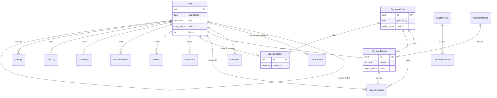

# Red de Referidos — F8 Endurecimiento (F1 Base: PR1 scaffold · PR2 0001_init · PR3 schema.prisma · PR4 seed + libs)

Fundación ejecutable. Las entregas llegan apiladas: PR2 migración SQL
autoritativa `0001_init`, PR3 espejo Prisma, PR4 seed + librería de settings +
helpers de árbol + contrato de cron (este).

## Toolchain

- Node >= 20 (verificado en v24.20.0), pnpm vía `npm install -g pnpm` (el
  `corepack enable` requiere admin en Windows, por eso la instalación global
  por npm es el fallback soportado con el mismo resultado: `pnpm -v`).
- Docker NO es necesario en máquinas de desarrollo. Los contenedores corren
  en el servidor vía Portainer Stack (git + auto-update polling/webhook).
- `.env` es obligatorio para cualquier comando de Prisma (ver más abajo) y está
  en `.gitignore`.

## Verificación local (PR4, sin demonio)

```sh
pnpm install
cp .env.example .env      # Windows: Copy-Item .env.example .env
pnpm db:validate          # prisma validate
pnpm db:generate          # prisma generate -> cliente tipado
pnpm db:check:drift       # compara schema.prisma contra todas las migraciones (exit 1 si hay drift)
pnpm typecheck            # tsc --noEmit
pnpm test                 # vitest run (963 tests, sin base de datos)
```

`pnpm db:check:drift` es la red de seguridad del DDL: verifica enums,
tablas, columnas (nombre, tipo, nulabilidad), claves primarias e índices en
AMBAS direcciones contra **todas** las migraciones (`0001_init` …
`0006_identity_login`), y exige que todo índice que solo existe en el SQL
esté listado en el bloque "Indexes NOT redeclared here" del schema.

`pnpm test` cubre el otro lado: `tests/settings-catalog.test.ts` deriva del
propio `migration.sql` qué settings lee el SQL en runtime y cuáles sólo
documenta el DDL, y falla si el seed no los siembra todos. Es el mismo
espíritu que el drift checker, aplicado a los datos en vez del esquema.

## Parámetros de negocio (§6, `lib/settings-catalog.ts`)

Los 40 parámetros de §6 viven en la tabla `settings` y se siembran con
`pnpm seed:root`. El código **nunca** los hardcodea: `lib/settings.ts` los lee
con caché de 60 s e invalidación `LISTEN/NOTIFY`, y una clave ausente lanza
`SettingsMissingError` en vez de devolver un default inventado.

```ts
import { getSettingOrThrow } from "@/lib/settings";

const quota = await getSettingOrThrow<number>("referral.max_direct_referrals");
```

`getSetting` devuelve `null` para una clave ausente (para las que sí son
opcionales, como `general.logo_key`); `getSettingOrThrow` es la que se usa
para todo paráetro del que el código depende.

## Variables de entorno

Además de `DATABASE_URL` y `TZ_DEFAULT`, el stack necesita:

| Variable | Para qué |
|---|---|
| `ROOT_EMAIL` | Correo del usuario raíz que crea `pnpm seed:root`. |
| `ROOT_PASSWORD` | Su contraseña. **Sólo para el seed inicial**; el seed aborta si falta. |
| `AUTH_SECRET` | **Requerida para que exista el login.** Firma la cookie de sesión (HS256). |
| `CRON_SECRET` | Protege `POST /api/cron/{job}`. Sin ella la ruta responde 503 (no se abre). |
| `UPLOADS_DIR` | Carpeta de comprobantes (default `./uploads`; en Docker `/app/uploads` con volumen propio, D42). |

### `AUTH_SECRET` es obligatoria y no tiene default

```sh
openssl rand -base64 32     # genera ~44 caracteres
```

La app **se niega a firmar sesiones** si `AUTH_SECRET` falta, tiene menos de 32
caracteres o sigue siendo el placeholder de `.env.example`
(`AuthSecretError`, D17). Es deliberado: un default silencioso firmaría sesiones
con una clave que está publicada en este repositorio, y cualquiera podría
forjar un token de ROOT. Un error ruidoso es el resultado correcto.

Se lee en **runtime**, no en build: Next.js inlinea los `process.env.FOO`
estáticos al compilar, y una acceso dinámico no se inlinea, así que la misma
imagen sirve para todos los entornos sin reconstruir.

## Autenticación (F2)

### Variables necesarias

Sólo `AUTH_SECRET`. `DATABASE_URL` ya hacía falta para todo lo demás.

### Flujo de login

1. `/login` valida el formulario con `react-hook-form` + Zod
   (`lib/auth/schema.ts`, mensajes en español).
2. El Server Action `loginAction` **vuelve a validar en el servidor** con el
   mismo esquema: la validación del cliente es una comodidad de UX, no un
   límite de confianza.
3. `lib/auth/login.ts` busca al usuario por email, cédula o usuario con una
   sola consulta `$queryRaw` parametrizada (`lib/users.ts:findByIdentifier`):
   `email` y `username` son CITEXT, y la cédula se compara normalizada. Si el
   identificador coincide con dos cuentas, el login se rechaza en vez de elegir
   una (D86). Prisma no puede consultar CITEXT directamente
   tipar, D14), y verifica la contraseña con Argon2id.
4. Si las credenciales son correctas, se firma un JWT (HS256) con el TTL de
   `security.session_ttl_hours` (efectivo: 8 h, tope D17/D65) y se guarda en la
   cookie `red_session`: `httpOnly`, `sameSite=lax`, `secure` en producción.
5. `middleware.ts` deja pasar `/admin` y `/portal` con sesión válida y
   redirige a `/login` sin ella. Cada página protegida **vuelve a comprobar**
   la sesión en el servidor (`lib/auth/require.ts`): el middleware redirige,
   no autoriza.
6. ROOT y ADMIN entran a `/admin`; el resto a `/portal`. Un `MEMBER` que pide
   `/admin` cae en `/portal`, no en `/login`.

### Recuperar o cambiar la contraseña del root

Si se pierde la contraseña del root **no hay correo de recuperación**: el
proyecto no tiene proveedor de correo (D7). El reset es una operación de
consola, deliberadamente explícita:

```sh
docker run --rm -v "$PWD:/app" -w /app --network <red-del-stack> \
  -e DATABASE_URL="postgresql://referidos:<password>@postgres:5432/referidos?schema=public" \
  -e AUTH_USER_IDENTIFIER="victorjoseraymond@gmail.com" \
  -e AUTH_USER_PASSWORD='<nueva contraseña fuerte>' \
  node:24-alpine sh -lc "corepack enable && pnpm install --no-frozen-lockfile && pnpm auth:set-password"
```

`AUTH_USER_IDENTIFIER` acepta las mismas tres formas que el login: correo,
cédula o usuario. `AUTH_USER_EMAIL` sigue funcionando como alias de
compatibilidad. Imprime cuántos usuarios coincidieron. Aborta si la contraseña
falta o si el identificador no existe: no hay default, no hay generación
automática y no hay contraseña en el repositorio.

Las sesiones ya abiertas siguen siendo válidas hasta 8 h después del reset
(las sesiones son JWT sin estado; ver D17). Para que el cambio surta efecto de
inmediato, hay que cerrar sesión o reiniciar el contenedor `app`.

## Base de datos (PR2 DDL + PR3 espejo)

`prisma/migrations/*/migration.sql` es la ÚNICA autoridad de DDL. `0001_init`
trae extensions ltree/pgcrypto/citext, 7 enums, 17 tablas, índices §5, EXCLUDE
de ciclos, triggers de árbol y `fn_user_move()`; `0002_settings_notify`,
`0003_weekly_reports`, `0004_tree_rebuild`, `0005_mv_payment_weekly` y
`0006_identity_login` la extienden (18 tablas en total + la vista materializada).

`prisma/schema.prisma` es su espejo exacto: mismos enums (tipos en minúsculas,
idénticos al SQL), mismas 18 tablas, mismos nombres de columna y tipos. Las
limitaciones de Prisma 6 se resuelven y documentan en el header del schema:

| SQL | Prisma |
|-----|--------|
| `CITEXT`, `LTREE` | `Unsupported("citext")` / `Unsupported("ltree")` |
| GiST / GIN / EXCLUDE / índices parciales | solo en SQL, listados en el schema |
| `DEFAULT now()`, `gen_random_uuid()` | `@default(dbgenerated(...))` |

`Unsupported` NO es consultable desde Prisma Client (queda fuera del modelo
generado): `users.email`, `users.path`, `invitations.email_target` y
`payment_reports.snapshot_path` requieren `$queryRaw`. **F2 resolvió el lookup
por email**: vive en `lib/users.ts` (`findByEmail`, `findByPublicCode`), siempre
parametrizado y con cast `::citext` explícito (D14). `insertUser` en
`lib/tree.ts` y `prisma/seed.ts` son raw por la misma razón.

### Diagrama ER



`mv_payment_weekly` (0005) no aparece: es una vista materializada sobre
`payment_reports`, no una tabla del espejo. `VerificationToken` y `RateLimit`
tampoco: son tablas sin FK hacia el resto.

**Nunca uses `prisma migrate dev`**: intentaría generar DDL desde el schema y
perdería ltree, GiST, EXCLUDE y los triggers. Solo `prisma migrate deploy`.

## Despliegue en el servidor (Portainer)

El stack corre la imagen *standalone* de Next.js: no incluye el CLI de Prisma
(`prisma` es devDependency y el runner solo copia `.next/standalone`,
`.next/static` y `public`). Por eso `pnpm db:migrate` y `pnpm seed:root` dentro
del contenedor `app` NO funcionan; se aplican desde un contenedor desechable
con el repo montado y la red del stack.

```sh
# 1. En el host de Portainer, con el repo disponible (es público):
git clone https://github.com/Vicray27/Redferidoss.git /opt/red-referidos
cd /opt/red-referidos

# 2. Nombre de la red del stack (por defecto <stack>_default):
docker network ls | grep <stack>

# 3. Migrar (aplica todas las migraciones pendientes, 0001_init … 0006_identity_login;
#    `migrate deploy` es idempotente, volver a correrlo no reaplica nada):
docker run --rm -v "$PWD:/app" -w /app --network <red-del-stack> \
  -e DATABASE_URL="postgresql://referidos:<password>@postgres:5432/referidos?schema=public" \
  node:24-alpine sh -lc "corepack enable && pnpm install --no-frozen-lockfile && pnpm db:migrate"

# 4. Sembrar root + catálogo §6 + métodos + ciclo corriente.
#    Es idempotente: correrlo de nuevo no duplica nada.
docker run --rm -v "$PWD:/app" -w /app --network <red-del-stack> \
  -e DATABASE_URL="postgresql://referidos:<password>@postgres:5432/referidos?schema=public" \
  -e ROOT_EMAIL="root@example.com" \
  -e ROOT_PASSWORD='<contraseña fuerte, sólo para este seed>' \
  node:24-alpine sh -lc "corepack enable && pnpm install --no-frozen-lockfile && pnpm seed:root"

# 5. Verificar:
docker exec -it <contenedor-postgres> psql -U referidos -d referidos -c '\dt'          # 18 tablas
docker exec -it <contenedor-postgres> psql -U referidos -d referidos \
  -c 'SELECT count(*) FROM settings;'      # 40
docker exec -it <contenedor-postgres> psql -U referidos -d referidos \
  -c "SELECT public_code, path, depth FROM users WHERE sponsor_id IS NULL;"   # root, 0
```

Los pasos 3 y 4 pueden ir en un solo `docker run` (`&& pnpm db:migrate &&
pnpm seed:root`) si preferís una sola pasada.

La contraseña del root nunca se guarda en el repositorio: se pasa por
`-e ROOT_PASSWORD` y el seed **aborta** si no está, en vez de inventar una.

### Rollback

Solo para una base nueva (greenfield, sin datos de producción). Rollback:
borrar la base (o `docker compose down -v`) y volver a correr el gate desde un
checkout limpio. El arranque (`CMD ["node", "server.js"]`) nunca migra solo.

`0002_settings_notify` es **aditiva** a propósito: `prisma migrate deploy`
guarda el checksum de cada migración aplicada, así que editar `0001_init` en
una base que ya la aplicó la rompería. Si hay que deshacer PR4 en una base ya
sembrada, `DELETE FROM settings WHERE key LIKE 'referral.%'` etc. es preferible
a revertir la migración.

### Si la migración falla

| Síntoma | Causa | Qué hacer |
|---|---|---|
| `P1012 Environment variable not found: DATABASE_URL` | el contenedor no recibió la variable | repetir el paso 3 con `-e DATABASE_URL=...` |
| `P1001 Can't reach database server` | red equivocada o `postgres` no está healthy | `docker network ls`, esperar el healthcheck del stack |
| `permission denied to create extension "ltree"` | se conectó con un usuario sin superusuario | usar `POSTGRES_USER` (primer usuario del volumen, superusuario) |
| `P3005 database schema is not empty` | la base ya tiene objetos | base greenfield: `DROP DATABASE` y recrear, luego repetir |
| error de sintaxis SQL a mitad del archivo | el archivo se editó a mano | restaurar el SQL de git y repetir; Prisma ejecuta cada migración en una transacción, verificar antes de reintentar |

Diagnóstico rápido del estado aplicado:

```sql
SELECT migration_name, finished_at IS NOT NULL AS ok FROM _prisma_migrations;
```

### Si el seed falla

| Síntoma | Causa | Qué hacer |
|---|---|---|
| `ROOT_PASSWORD is required to run the seed` | falta la variable | repetir el paso 4 con `-e ROOT_PASSWORD=...` |
| `ROOT_ALREADY_EXISTS: only one root user is allowed` | ya había una raíz y el seed no la detectó | es el comportamiento esperado del trigger; el seed ya lo evita con su `SELECT` previo, si aparece es una doble ejecución concurrente |
| `SETTINGS_MISSING: the setting "…" does not exist` en runtime | la base no fue sembrada | correr `pnpm seed:root` (paso 4); el error es intencional, nunca hay default |
| `UNSUPPORTED_CYCLE_FREQUENCY` | alguien cambió `payments.frequency` a BIWEEKLY/MONTHLY | §6 no define el ancla para esas frecuencias (D12); volver a `WEEKLY` |

## Estructura del slice PR4

| Archivo | Qué hace |
|---|---|
| `lib/settings-catalog.ts` | Los 40 parámetros de §6 (datos puros, sin DB). |
| `lib/settings.ts` | Lector tipado: caché 60 s, invalidación LISTEN/NOTIFY, throw en clave ausente. |
| `prisma/seed.ts` | `pnpm seed:root` — root + catálogo + métodos + ciclo, idempotente. |
| `lib/cycles.ts` | Ventanas de ciclo en `general.timezone`, sin librería de fechas. |
| `lib/tree.ts` | Helpers de árbol: label ltree, derivación de path, `fn_user_move`, conteo por nivel. |
| `app/api/cron/[job]/route.ts` | Contrato `POST /api/cron/{job}`: autenticación con `CRON_SECRET` y envelope §10 (los cuerpos llegan a partir de F4a; la cadencia, en F7). |
| `jobs/index.ts` | Registro de los 6 jobs de §9 con su `timing` para el scheduler (D62). |
| `prisma/migrations/0002_settings_notify/` | Trigger que emite `settings_changed`. |

## Estructura de la autenticación (F2)

| Archivo | Qué hace |
|---|---|
| `lib/users.ts` | `findByEmail`, `findByIdentifier` (email, cédula o usuario) y `findByPublicCode` sobre `$queryRaw` con `::citext` (D14, D86). |
| `lib/auth/guards.ts` | Rol y ruta como funciones puras; `safeNextPath` anti open-redirect (D15). |
| `lib/auth/session.ts` | Token JWT HS256 con `jose`, Edge-safe; `AUTH_SECRET` en runtime (D16, D17). |
| `lib/auth/schema.ts` | `loginSchema` de Zod, compartido por cliente y servidor. |
| `lib/auth/login.ts` | `authenticate()` sin framework ni DB: sin enumeración y con igualación de tiempos. |
| `lib/auth/rate-limit.ts` | Fallos por 15 min leídos de `security.login_rate_limit_per_15m`, ventana fija, clave hasheada (D18/D64). |
| `lib/auth/deps.ts` | Une `authenticate()` y el throttle con las implementaciones reales. |
| `lib/auth/actions.ts` | Server Actions `loginAction` / `logoutAction`. |
| `lib/auth/require.ts` | La autoridad de acceso en el servidor: `requireSession` / `requireStaffSession`. |
| `middleware.ts` | Redirige; no autoriza. Ver `lib/auth/require.ts`. |
| `app/login/` | Formulario (react-hook-form + Zod) y su página. |
| `app/admin/`, `app/portal/` | Zonas protegidas; identity visible, dashboard en F5. |
| `scripts/set-password.ts` | `pnpm auth:set-password`, el único reset de contraseña posible. |

## La red (F3)

Registro por invitación, panel de invitaciones y lecturas de red con recorte
por scope (§7.1). Los textos entre paréntesis son las secciones del documento
de referencia.

### Endpoints

| Método y ruta | Qué hace | Protección |
|---|---|---|
| `POST /api/auth/register` | Registro vía invitación (§8.3): exige usuario y cédula, acepta correo opcional (una invitación dirigida sí lo exige), valida, hashea fuera de la transacción, reválida bajo `FOR UPDATE`, crea usuario + obligación + auditoría, emite sesión (D86). | `assertSameOrigin` + throttle por IP (`security.register_rate_limit_per_hour_per_ip`, D30/D64) |
| `GET /api/public/invite/[slug]` | Resuelve `/r/{code}` o `/invite/{token}`: patrocinador, cupos, campos del formulario. Sin `emailTarget`. | throttle por IP (60/10 min) |
| `GET /api/network/children` | Hijos directos paginados por keyset; `parentId` default = uno mismo. | `requireApiSession` + `assertCanViewUser` + `scopeFilter` |
| `GET /api/network/search` | Búsqueda por nombre o código dentro del alcance del actor. | ídem |
| `GET /api/network/nodes/[id]` | Ficha + breadcrumb; contacto y campos personalizados sólo staff o la propia persona. | ídem |

Todos responden el envelope de §10: `{ok:true,data}` o
`{ok:false,error:{code,message,details?}}`.

### Páginas y componentes

| Ruta / archivo | Qué hace |
|---|---|
| `/r/[code]`, `/invite/[token]` | Página pública de registro; invitación inválida o sin cupo muestra un error explícito, no un formulario. |
| `components/register/register-form.tsx` | Formulario: base con `registerCoreSchema` (misma definición que el servidor) + campos dinámicos. |
| `components/dynamic-form/` | `build-zod-schema.ts` (espejo cliente de las reglas del servidor) y `field-renderer.tsx`; los FILE se omiten (§8.3, D25). |
| `/portal` | Inicio: cupos, tamaño de red, referidos directos; la semana y los aportes viven en `/portal/semana` (F4a). |
| `/portal/network`, `/portal/network/[id]` | Árbol perezoso con búsqueda y ficha con subárbol, breadcrumb y campos personalizados. |
| `/portal/invitations` | Link permanente con QR, invitación de un solo uso, pendientes y revocar (Server Actions). |
| `components/network/network-tree.tsx` | Árbol colapsable; cada expansión es `GET /api/network/children`. |
| `components/link-box.tsx`, `components/qr-code.tsx` | Link absoluto + copiar + QR generado en el navegador (D34). |

### Librerías de la fase

| Archivo | Qué hace |
|---|---|
| `lib/invitations.ts` | Resolver ambos tipos de link, cupo (R3), emitir/revocar/consumir tokens; `@inv:*`. |
| `lib/registration.ts` | `registerUser()` con la carrera A3, R3/R4, campos dinámicos y auditoría; `@reg:*`. |
| `lib/registration-deps.ts` | Cableado real + los dos throttles de la fase. |
| `lib/invitations-actions.ts` | Server Actions de crear/revocar invitación (CSRF vía Next). |
| `lib/network.ts` | `listChildren`/`search`/`node`/`breadcrumb`/`subtreeSize`/`customValues`, todos con scope; `@net:*`. |
| `lib/api.ts` | `withApi`, `okResponse`, `parseJsonBody`, `parseQuery`, `assertSameOrigin`, `clientIp`. |
| `lib/throttle.ts` | Ventana fija por clave, reloj inyectable (D30). |
| `lib/register-schema.ts` | Contrato Zod del formulario, compartido cliente/servidor. |

### Verificación local

```sh
pnpm test        # 385+ tests de unidad, sin base de datos
pnpm typecheck
pnpm db:check:drift
```

Los tests de F3 cubren: cupo y consumo de invitaciones (con curas de reloj),
el espejo cliente de las reglas dinámicas, los helpers de API, y un invariante
que falla si alguna lectura de red viaja sin fragmento de scope para un
miembro. Las mitades de integración contra Postgres real quedan marcadas para
el servidor (igual que en fases anteriores). Las decisiones D19–D36 están en
`docs/decisiones.md`.

## La semana y los aportes (F4a)

Ciclos planificados, reporte semanal de la Visión Celular y el aporte de la
semana con revisión de staff (§5.5, §8.2, §8.5). La corrección de privacidad
D40 (el miembro ve sólo a sus referidos directos) aplica a todas las lecturas.

### Endpoints

| Método y ruta | Qué hace | Protección |
|---|---|---|
| `POST /api/uploads` | Sube un comprobante (multipart, campo `file`, ≤ 10 MB, JPG/PNG/WEBP/PDF por magic bytes) y devuelve `fileId`/`key` (D42). | sesión + `assertSameOrigin` + throttle 30/10 min por usuario |
| `GET /api/files/[key]` | Sirve un comprobante guardado en disco; sólo su dueño o staff (D45). | `requireApiSession` + dueño-o-staff + `Cache-Control: private, no-store` |
| `POST /api/cron/{job}` | F4a: `cycle:ensure` y `cycle:obligations`; F7 completó los 6 (D59–D62) y la cadencia corre en la app — la ruta queda como disparo manual/externo. | `CRON_SECRET` + mismo-origen |

Todos responden el envelope de §10.

### Páginas

| Ruta | Qué hace |
|---|---|
| `/portal/semana` | Reporte semanal (upsert hasta el cierre, D44), reporte de aporte con comprobante en dos pasos (D29/D42), historial propio y tablero "Visión Celular" con el alcance del actor. |
| `/admin/revisiones` | Cola de aportes pendientes: aprobar cumple la obligación y notifica; rechazar exige motivo (D43). |
| `/admin/configuracion` | Los 40 ajustes de §6 por grupo: sólo escribe lo que cambió, audita cada cambio y respeta `editable_by`. |

### Librerías de la fase

| Archivo | Qué hace |
|---|---|
| `lib/payments.ts` | Ventana `[starts_at, due_at)`, monto vs `expected_amount`, referencia/comprobante (D43), revisión y cumplimiento de `cycle_obligations`; `@pay:*`. |
| `lib/weekly-reports.ts` | UPSERT por `(user_id, cycle_id)` con validación de contadores y visitantes; `@weekly:*`. |
| `lib/settings-admin.ts` | Valida contra el catálogo, escribe `settings`, audita cada cambio e invalida la caché local; `@settings:*`. |
| `lib/storage.ts` / `lib/uploads.ts` | Guardado local en `UPLOADS_DIR`, sniffing de magic bytes y sha256. |
| `lib/payments-actions.ts`, `lib/weekly-actions.ts`, `lib/settings-actions.ts` | Server Actions de las tres pantallas: traducen `AppError` a mensajes y revalidan; ninguna regla vive ahí. |
| `jobs/execute.ts` | `cycle:ensure` (planifica 5 ventanas) y `cycle:obligations`, idempotentes por construcción (D41); F7 sumó los otros cuatro cuerpos (D59–D62). |

### Verificación local

```sh
pnpm test        # 501 tests de unidad, sin base de datos
pnpm typecheck
pnpm db:check:drift
```

Las decisiones D37–D45 están en `docs/decisiones.md`.

## La planilla consolidada (F4b)

La lectura de conjunto del staff: una fila por persona con obligación, reporte
semanal u ofrenda en el ciclo (§8.4), con los totales derivados de las MISMAS
filas que se muestran, impresión A4 (el PDF sale del diálogo del navegador) y
exportación a Excel o CSV (D46, D47, D48).

### Endpoints

| Método y ruta | Qué hace | Protección |
|---|---|---|
| `GET /api/admin/reports/export?cycle=…&format=xlsx\|csv` | Descarga la planilla consolidada de esa semana: XLSX (write-excel-file, D47) o CSV RFC 4180 con BOM porque Excel lo necesita para leer acentos. `format` por defecto `xlsx`; nombre `planilla-<period_key>.<ext>`. | `requireApiSession` + guard staff del servicio (D39) + `Cache-Control: private, no-store` |

Al fallar responde el envelope de §10; al responder bien, el cuerpo es el archivo.

### Páginas

| Ruta | Qué hace |
|---|---|
| `/admin/reportes` | Planilla consolidada: selector de semana, tira de totales (personas, reportaron, no reportaron, asistieron, ofrendaron, montos, visitantes) y la matriz de 22 columnas de D46. Enlaces a impresión y a las dos exportaciones. |
| `/admin/reportes/imprimir?cycle=…` | Cara de papel: A4 apaisada, sin chrome de navegación, con sello "Generada el…"; el botón "Imprimir / Guardar PDF" abre el diálogo del navegador (D48). |

### Librerías de la fase

| Archivo | Qué hace |
|---|---|
| `lib/reports.ts` | `createReportsService` (solo staff): ciclos y planilla consolidada del ciclo; `SHEET_HEADERS` + `sheetMatrix` + `sheetCsv` son la única definición de las filas — pantalla, CSV, XLSX e impresión consumen esa matriz — y los totales se suman en céntimos BigInt sobre las mismas filas (`@reports:*`). |

### Verificación local

```sh
pnpm test        # 534 tests de unidad, sin base de datos
pnpm typecheck
pnpm db:check:drift
```

Las decisiones D46–D48 están en `docs/decisiones.md`.

## El panel de administración (F5)

La portada del staff: los ocho KPIs de la semana (§8.5), cinco gráficas SVG
dibujadas en el servidor sin dependencias, la tabla maestra de aportes con doce
filtros, acciones en lote y exportación, y la matriz de cumplimiento
persona × semana con drill-down (D49–D54).

### Endpoints

| Método y ruta | Qué hace | Protección |
|---|---|---|
| `GET /api/payments/export?format=xlsx\|csv&ids=…` | Descarga la tabla maestra: el conjunto filtrado (los mismos filtros de la página) o, si `ids` está presente, EXACTAMENTE esa selección — los filtros se ignoran a propósito y una selección vacía es 400, nunca un fallback silencioso. Tope 10.000 filas. XLSX (write-excel-file, D47) o CSV RFC 4180 con BOM. `format` por defecto `xlsx`; nombre `pagos-YYYY-MM-DD.<ext>`. | `requireApiSession` + guard staff del servicio + `Cache-Control: private, no-store` |
| `GET /api/payments/users?q=…&limit=…` | Autocompletado de persona para los filtros de árbol: `q` hasta 100 caracteres, `limit` 1..20 (default 10). Responde `{ query, results }`. | `requireApiSession` + guard staff de `dashboard.searchUsers` |

Al fallar responden el envelope de §10; al responder bien, la exportación es el archivo.

### Páginas

| Ruta | Qué hace |
|---|---|
| `/admin` | Panel: ocho KPIs de la semana, tira de cinco gráficas (barras, línea, barras horizontales, mapa de calor) y las cinco puertas de navegación. Selectores de semana y ventana (12/26/52); una semana inexistente degrada a la vigente con aviso. |
| `/admin/pagos` | Tabla maestra: doce filtros GET (semana(s), fechas, estado, persona/subárbol, nivel, método, monto, moneda, con comprobante, texto, campos personalizados), paginación real, selección por página con acciones en lote (aprobar, rechazar con motivo, reasignar semana) y exportación filtrada o de la selección. La URL filtrada es compartible. |
| `/admin/cumplimiento` | Matriz persona × semana: cuatro estados con leyenda (aprobado / pendiente / incumplido / exento), ventanas 4/12/26 y drill-down por celda a la tabla maestra filtrada por persona y semana. Avisa si la red supera las 500 personas mostradas (D54). |

### Librerías de la fase

| Archivo | Qué hace |
|---|---|
| `lib/charts.ts` | Geometría pura de las gráficas (barras, línea, mapa de calor): sin React ni DOM, verificable con números (`niceMax`, `heatColor`, `resolveChartWindow`). D49. |
| `lib/dashboard.ts` | `createDashboardService` (solo staff): `getOverview` (KPIs y series), `getCompliance` (matriz, tope 500), `searchUsers`/`userOption`/catálogos de métodos y campos. Toda la aritmética de dinero en céntimos BigInt. D50/D54. |
| `lib/payments-admin.ts` | Filtros (`parsePaymentsFilters`), `listPayments`/`exportRows`/`selectedRows` y la matriz de exportación (cabeceras + celdas): CSV y XLSX salen de esa única matriz; la pantalla tiene su propio render y comparte con la exportación la lista de campos dinámicos (una columna extra por campo de panel, D57). Tope de exportación 10.000 filas. D51/D57. |
| `lib/payments-actions.ts` | Server actions del toolbar (`bulkReviewPaymentsAction`, `reassignPaymentsAction`) sobre `reviewMany`/`reassignReports` de `lib/payments.ts`, con tope de 500 ids por lote. D52. |
| `components/charts/*` | Los cuatro componentes SVG (barras verticales/horizontales, línea, mapa de calor) que dibujan la geometría de `lib/charts.ts` como componentes de servidor. D49. |

### Verificación local

```sh
pnpm test        # 641 tests de unidad, sin base de datos
pnpm typecheck
pnpm db:check:drift
```

Las decisiones D49–D54 están en `docs/decisiones.md`.

## La configurabilidad (F6)

El panel que evita tocar código para operar: los ajustes de §6, el catálogo de
métodos de pago y los campos personalizados de §8.5 (D55–D58). Las mutaciones
son Server Actions sobre servicios con guard de staff (D29); no hay API REST
paralela (D58).

### Páginas

| Ruta | Qué hace |
|---|---|
| `/admin/metodos-pago` | Catálogo de métodos: alta con código inmutable, edición de etiqueta/orden/estado y reordenamiento denso. No hay borrado: desactivar es el retiro (D55). Las etiquetas del catálogo viajan a la semana, la revisión y la planilla. |
| `/admin/campos-personalizados` | CRUD de campos personalizados por entidad (USER / PAYMENT_REPORT) con previsualización en vivo: la identidad (entidad, código, tipo) queda congelada al crear y desactivar es el único retiro (D56). Los campos de aporte activos alimentan el formulario de la semana, y los marcados `show_in_dashboard` son columnas de `/admin/pagos` y de sus exportaciones (D57). |

### Librerías de la fase

| Archivo | Qué hace |
|---|---|
| `lib/custom-fields.ts` | El motor único de campos personalizados: validación/coerción por tipo, recolección de valores (`collectCustomValues`), verificación de unicidad en aplicación y `formatCustomValue` para lectura (D56/D57). |
| `lib/custom-fields-admin.ts` | Servicio del CRUD admin (solo ROOT/ADMIN): listar/crear/editar/reordenar/desactivar definiciones con auditoría por cambio (D56). |
| `lib/custom-fields-actions.ts` | Server Actions de la pantalla: guard de staff, ejecuta el servicio y revalida las rutas que muestran campos. |
| `lib/payment-methods-admin.ts` | Servicio del catálogo (solo ROOT/ADMIN): alta/edición/desactivar/reordenar; `code` inmutable (D55). |
| `lib/payment-methods-actions.ts` | Server Actions del catálogo: guard de staff, servicio y revalidación de las pantallas que muestran métodos. |

### Guía rápida (operación)

- Crear un campo personalizado: `/admin/campos-personalizados` → "Nuevo campo"
  → entidad, código (no cambia después) y tipo. Los defaults prellenan los
  formularios; los campos de aporte activos aparecen en el envío de la semana
  (D56/D57).
- Cambiar el límite de referidos u otro ajuste de §6: `/admin/configuracion`;
  solo viaja lo modificado, cada cambio se audita y el formulario respeta
  `editable_by`.
- Retirar un método de pago o un campo: desactivarlo en su pantalla — el
  histórico queda intacto (D55/D56).

### Verificación local

```sh
pnpm test        # 688 tests de unidad, sin base de datos
pnpm typecheck
pnpm db:check:drift
```

Las decisiones D55–D58 están en `docs/decisiones.md`.

## Los jobs y las notificaciones (F7)

La bandeja in-app con badge de sesión, los seis jobs de §9 completos y su
cadencia sin pg_cron (D59–D62). No hay correo ni WhatsApp: §9 los nombra, pero
el proyecto no tiene proveedor — las notificaciones viven in-app (D59).

### Endpoints

| Método y ruta | Qué hace | Protección |
|---|---|---|
| `POST /api/cron/{job}` | Los seis jobs de §9 implementados; disparo manual o externo (la cadencia corre en la app, D62). | `CRON_SECRET` (`Authorization: Bearer` o `x-cron-secret`) |

Cada job responde su resumen en el envelope de §10.

### Páginas

| Ruta | Qué hace |
|---|---|
| `/portal/notificaciones` | Bandeja del miembro: no leídas primero, "marcar como leída". |
| `/admin/notificaciones` | Bandeja del staff, mismo contrato. |

El shell de sesión muestra el badge de no leídas en ambos portales.

### Librerías de la fase

| Archivo | Qué hace |
|---|---|
| `lib/notifications.ts` | Lecturas de la bandeja (`@ntf:*`): listado, conteo de no leídas, marcado como leída. |
| `lib/notifications-actions.ts` | Server Actions de las dos bandejas, con guard por rol. |
| `jobs/execute.ts` | Los seis cuerpos: `cycle:reminders` (D59), `cycle:close` con strikes y suspensión (D60), `tree:verify` con `fn_tree_rebuild()` (D61), `files:gc` + limpieza de `rate_limits` (D62). Los jobs multi-sentencia toman advisory lock (D41/D59). |
| `jobs/scheduler.ts` | Cadencia in-process: tick alineado al minuto local en `general.timezone`, orden del registry (ensure → obligations → close) y sin solapamiento (D62). |
| `instrumentation.ts` | Arranque del scheduler en producción (Node, no build) con kill switch `JOBS_SCHEDULER=off` (D62). |
| `prisma/migrations/0004_tree_rebuild/` | `fn_tree_rebuild()`: reescribe `users.path/depth` y `user_closure` desde `sponsor_id` (D61). |

### Operación (jobs)

- Correr uno ya: `curl -X POST -H "Authorization: Bearer $CRON_SECRET" https://…/api/cron/cycle:close`.
- Apagar la cadencia sin redeploy: `JOBS_SCHEDULER=off`.
- Cambiar un horario: `timing` en `jobs/index.ts`; la zona horaria sale de `general.timezone`.
- Migración 0004: `pnpm db:migrate` la aplica (es una función, aditiva).

### Verificación local

```sh
pnpm test        # 963 tests de unidad, sin base de datos
pnpm typecheck
pnpm db:check:drift
```

Las decisiones D59–D62 están en `docs/decisiones.md`.

## El endurecimiento (F8)

Cierre de la fase: cabeceras de seguridad y umbrales configurables, el
dashboard sobre la vista materializada `mv_payment_weekly`, `seed:demo` a
escala, cobertura medida de `lib/` con umbral, el viaje E2E completo sobre una
base descartable y la bandeja de notificaciones con paginación keyset
(D63–D73).

### Endpoints

| Método y ruta | Qué hace | Protección |
|---|---|---|
| `GET /portal/notificaciones?antes=<id>` | Página siguiente (más antigua) de la bandeja; el cursor es el id del último aviso visto (D73). | Sesión |
| `GET /admin/notificaciones?antes=<id>` | Ídem para staff; mismo contrato. | Sesión de staff |

### Artefactos de la fase

| Archivo | Qué hace |
|---|---|
| `lib/security-settings.ts` | Lee `security.*` del catálogo con fallback explícito (D64). |
| `lib/security-headers.ts` | CSP y cabeceras en todas las respuestas; `style-src 'unsafe-inline'` a propósito (D63). |
| `lib/mask.ts` | Enmascarado de datos sensibles al serializar (D66). |
| `prisma/migrations/0005_mv_payment_weekly/` | La MV con datos y su índice único, requisito de `REFRESH CONCURRENTLY` (D67). |
| `lib/mv-refresh.ts` | Refresh best-effort al aprobar + cada 5 min desde el scheduler (D67/D68). |
| `prisma/seed-demo.ts` | Demo a escala: presets de §15 y escenario de volumen; cumplimiento al 85 % modelado por persona (D70). |
| `vitest.config.ts` | Umbral global del 80 % en cuatro métricas (líneas, ramas, funciones, statements) sobre `lib/**` (D71). |
| `playwright.config.ts` + `e2e/` | El viaje de §16 completo contra una base descartable por corrida (D72). |
| `lib/notifications.ts` | Keyset en `listForUser`: cursor por id, tupla `(created_at, id)` y `LIMIT n+1` (D73). |

### Verificación local

```sh
pnpm test             # 963 tests de unidad, sin base de datos
pnpm test:coverage    # umbral 80 % en 4 métricas sobre lib/** (actual: 86,25 % líneas / 91,21 % ramas)
pnpm test:e2e         # viaje completo en base descartable (detener antes pnpm dev)
pnpm typecheck
pnpm db:check:drift
pnpm build
```

### Divergencias documentadas (F8)

- Exportaciones > 10.000 filas (§14): no hay generación en background. La
  exportación maestra de pagos rechaza explícitamente por encima de
  `PAYMENTS_EXPORT_MAX_ROWS` (10.000) — falla segura, sin truncado silencioso —
  y la planilla consolidada (una fila por persona) se genera síncrona y sin
  tope; con la red actual (~1.900 personas) está lejos del umbral. Queda como
  deuda explícita si el volumen real lo supera (D73).
- `security.require_2fa_for_admin`: el setting existe en el catálogo (default
  `false`) y ningún flujo lo impone todavía; §6 lo lista como parámetro, no
  como funcionalidad de una fase.

Las decisiones D63–D73 están en `docs/decisiones.md`.
